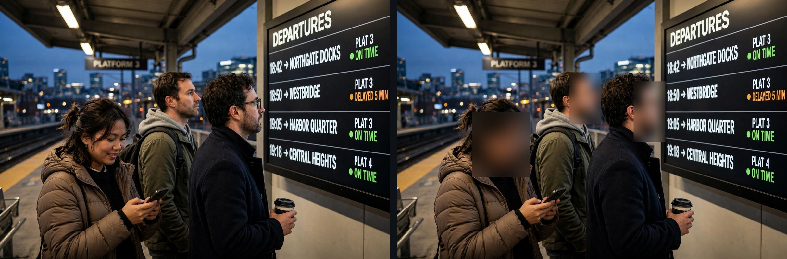
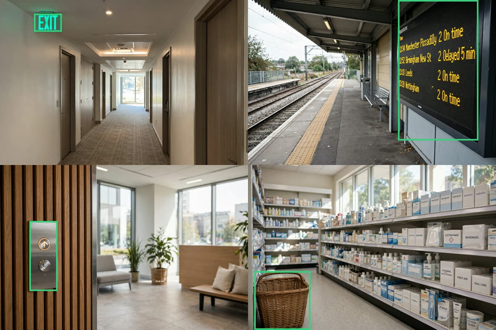
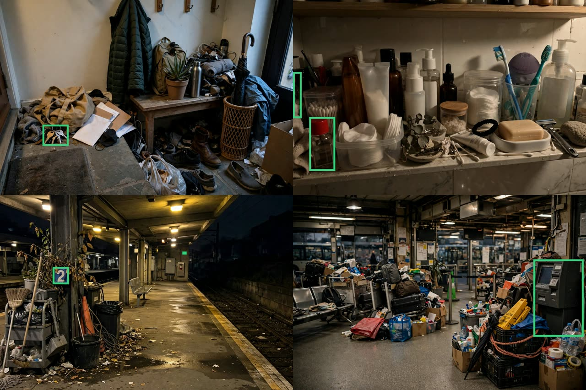

# EveryMuse: what we measured, and why it's built this way

**Source of every number:**
- Measured on Meta's models from the deployed server on Nov 3 and 4, 2026, using the scripts in `server/scripts/`.
- The raw results are in `server/eval/results/`.
- Spoken prompts were synthesized with macOS `say` and streamed in real time, as a phone would.
- **EveryMuse was called Earshot until Nov 4, 2026.**
  - Every test here ran under that name, so the spoken prompts began "Hey Earshot". Where a result depends on the exact words spoken, they're quoted as they were.
  - The new wake phrase, "Hey EveryMuse", passes the unit tests but hasn't been tested by voice yet.

## 1. Does the live demo hold up?

All 18 of 18 trials passed: 3 trials of each judge prompt against https://earshot-yuansshi.fly.dev (`scripts/eval_live.py`).
- A second full run passed 18 of 18 too, with similar times (`eval/results/live-2026-11-04-final.json`).
- A third, after all the language work, passed 18 of 18 (`eval/results/live-2026-11-04-after-languages.json`).
- A last check of each prompt, after the final change, passed 6 of 6.

| Prompt | Passed | First word (p50) | Done (p50) | Cost per run |
|---|---|---|---|---|
| Wake word, then weather (spoken) | 3/3 | 2.3 s | 6.7 s | $0.0075 |
| Look + Find it (sample photo) | 3/3 | 3.5 s | 7.2 s | $0.0051 |
| Remember where I parked, then ask | 3/3 | 1.2 s | 2.6 s | $0.0025 |
| Rewind: "what was that address she just said?" (spoken) | 3/3 | 2.1 s | 3.9 s | $0.0048 |
| Heads-up: a friend's dinner plan becomes a reminder (spoken) | 3/3 | Offer 3.7 s after they stop talking | 4.7 s after the yes | $0.0069 |
| Muse Wonder: "look into e-bikes under $1,500 and get back to me" | 3/3 | – | 48 s, reported back | $0.12 |

**Other checks:**
- **Cold start:** from fully stopped, the page loads in 5.7 s and the first word comes 2.6 s after asking (3 trials; see section 10).
- **Out of credit:** if the Meta key is refused (401, 402, 403 or 404), typed questions fall back to Muse Spark Open. Speech recognition still needs a working Meta key. When it refuses three times in a row, the page now says so ("EveryMuse can't hear you right now… You can still type"), instead of a microphone that silently hears nothing.
- **Out of credit, for real.** The hackathon's Meta credit ran out during these tests, at 9:37 AM PT on Nov 4; the key now gets HTTP 402, "Billing verification failed". Measured on the live server after that:
  - typed questions went to Muse Spark Open, though Fireworks itself answered some calls with 503 "overloaded", so the fallback now retries 3 times;
  - a photo question was still answered correctly from the image, without SAM 3.1's outline;
  - speech recognition accepted each session, then closed it (1008). The relay now counts a session as working only once it sends something, and the page shows its "can't hear you" notice 2.7 s after a hands-free session starts;
  - all spoken prompts failed until credit is added;
  - a cold start still worked, after the trial stopped the machine at 10:14 AM: the page loaded in 6.3 s, and a typed question's first word came 10.3 s after asking (4.4 s on the next visit), against 2.6 s on Meta's hosted Muse Spark;
  - each fresh start had forgotten the refusal, so its first turn tried Meta again before falling back, and `/healthz` reported the brain live until then. The server now keeps refusals on the volume (`refused.json`) across restarts. The next cold start, at 10:58 AM, went straight to the fallback: the page in 5.4 s, the first word in 4.2 s. Muse Spark Open's own times vary (3.3 to 6.1 s on warm visits).
- **Speech recognition:** a transcript arrives 0.17 to 0.30 s after speech ends.
- **History:** resending the conversation, instead of chaining with `previous_response_id`, cut the answer after a tool from 7.3 s to 2.1 s (`scripts/probe.py`).
- **Unit tests:** 99, all using fake models and fake speech recognition.

## 2. Heads-up: the models work as a cascade

Heads-up is the feature that makes EveryMuse more than an agent on standby. It notices something you'll want in speech that wasn't said to it, and offers to act on it. Each stage hands off to a bigger model only when the one before it finds something:

| Stage | Model | Runs when | Cost |
|---|---|---|---|
| Hear | Muse Voice Transcribe, realtime | Always, while listening | $0.18 per hour |
| Notice | Muse Spark 1.2 at minimal effort | Once a speaker pauses | $0.0011 per screen |
| Act | Muse Spark 1.3, with tools and web search | Only after you say yes | About $0.005 |
| Dig | Muse Wonder, in the background | Only for research offers | $0.04 to $0.22 |
| Survive | Muse Spark Open, open weights on Fireworks | Only if Meta's API fails | Same price as Spark |

### Which model should screen overheard speech?

We ran 560 calls (`scripts/eval_headsup.py`) over 40 labeled snippets, 2 runs each.
- **Should get an offer (20):** plans with a time or place, requests to you, details worth keeping, and announcements that affect your saved plans.
- **Shouldn't (20):** small talk, TV, radio ads, vague plans, past events, and other people's trains.

| Screener | Precision | Recall | False offers | p50 | p90 | Cost per hour* |
|---|---|---|---|---|---|---|
| **Muse Spark 1.2, minimal (shipped)** | **100%** | **100%** | **0%** | **2.0 s** | **3.5 s** | **$0.07** |
| Muse Spark 1.3, minimal | 100% | 92% | 0% | 3.1 s | 5.6 s | $0.09 |
| Muse Spark 1.3, low | 100% | 55% | 0% | 6.0 s | 9.9 s | $0.19 |
| Muse Spark 1.1, minimal | 100% | 100% | 0% | 2.4 s | 61 s | $0.10 |
| Muse Spark 1.3 Contributor, minimal | 100% | 98% | 0% | 2.4 s | 5.4 s | $0.004 |
| Muse Spark Open on Fireworks, low | 100% | 88% | 0% | 6.6 s | 14 s | $0.12 |
| Muse Wonder 1.0, low | 100% | 98% | 0% | 3.2 s | 5.6 s | $0.46 |

\*At 60 screenings an hour of nearby conversation. Speech recognition adds $0.18 an hour.

**What the comparison showed:**
- **The older, smaller-effort model won.** Muse Spark 1.2 at minimal effort caught all 40 real moments across both runs, offered nothing on chatter, and was the fastest and cheapest standard-mode option. It's what Heads-up uses.
- **More reasoning hurt.**
  - Even at minimal effort, Spark 1.3 spends about 300 tokens thinking.
  - At low effort, 12 of its 80 replies ran out of tokens before answering, which drops recall to 55%.
- **Using the deepest model for everything buys nothing.** Muse Wonder matched the quality at about 7 times the cost.
- **Contributor mode is about 16 times cheaper, but we rejected it.** Its content may be used to train Meta's models, and here that content is other people's words.
- **Spark 1.1 has a long tail:** 4 calls took about 61 s. That's unusable for a real-time cue.

### A harder test set, and a better prompt (`scripts/eval_headsup_more.py`)

All 40 hand-written snippets passed. So Muse Wonder, a different model, wrote 120 new ones in 12 categories, 10 each, including near-misses meant to trip the screener:
- other people's plans;
- store announcements;
- announcements that don't touch the user's notes.

Each snippet's label comes from its category. Each was screened twice, with the prompt before and after one change: other people's plans and staff announcements aren't the listener's.

| Screener prompt | Original 40: precision / recall | Wonder's 120: precision / recall | False offers on the 120 |
|---|---|---|---|
| Before | 100% / 95% | 80.6% / 100% | 17.1% |
| **After (shipped)** | **100% / 100%** | **90.0% / 99%** | **7.9%** |

The "before" row missed 2 of the original 40's positives in this run; the first run, in the table above, missed none.
- **Store and staff announcements went from 7 offers in 20 to none.** Announcements that don't touch the notes went from 1 to none.
- **Other people's plans still drew an offer 9 times in 20, but most of those labels were wrong.** Reading the 5 distinct snippets behind them, 4 were addressed to the listener: "Don't forget, Mum's physio moved to Wednesday", "Book a taxi for Grandpa Leo". So the generated label was wrong, not the screener, and the real precision is higher than 90%. The one real miss was a plan between other people. Speaker labels from Muse Voice Transcribe's diarization mode, in section 8, would catch those.
- **Small talk, past events and vague plans drew no offers.** Of the TV and radio snippets, one drama line ("Call Detective Lawson, I'm at the old depot") drew an offer in both runs.

### A large, cross-checked test: would a deeper model screen better? (`scripts/eval_headsup_hard.py`)

The biggest test of the screener choice:
- **Muse Wonder wrote 2,400 more snippets,** 200 in each of the 12 categories, repeats removed.
- **A second Muse Wonder pass judged each snippet on its own,** without seeing its category. Only the 2,155 where it agreed with the label were kept: 782 that deserve an offer and 1,373 that don't. That way a mislabeled snippet can't count against a screener.
- **The judge was strictest about "details worth keeping",** rejecting 128 of those 200 labels.

Three Meta screeners, all with the shipped prompt, then screened all 2,155 once each. The brackets are 95% intervals.

| Screener | Precision | Recall | False offers | p50 | Cost per screen |
|---|---|---|---|---|---|
| **Muse Spark 1.2, minimal (shipped)** | **92.9%** (91.0–94.5) | **99.4%** (98.5–99.7) | 4.3% | **1.3 s** | **$0.0013** |
| Muse Spark 1.3, minimal | 94.3% (92.5–95.7) | 97.4% (96.1–98.3) | 3.4% | 3.3 s | $0.0015 |
| Muse Wonder 1.0, low | 93.7% (91.8–95.2) | 99.0% (98.0–99.5) | 3.8% | 2.7 s | $0.0089 |

**What it showed:**
- **At this size, precision is a tie.** The three intervals overlap. An earlier run on 431 snippets had Muse Wonder 2.6 points ahead, which was noise.
- **The shipped screener has the best recall,** clearly better than Spark 1.3's, the newer model. It's also the fastest, by 2 to 2.5 times, and 7 times cheaper than Wonder. For a cue that has to come while the moment is still happening, that settles it.
- **Every screener's false offers are mostly the same kind.** Of 46 to 59 false offers each, 35 to 41 were plans that belong to other people. A bigger model doesn't fix that, because the text alone doesn't say whose plan it is. Knowing who is speaking would; section 8 measures that Muse Voice Transcribe's diarization can.
- **The test cost about $45 of Meta credit:** $25 of screening, and the rest for Muse Wonder writing and judging. The Fireworks fallback was left out of this run because it's slow (16 s a call), and it doesn't run on Meta credit; on the 431-snippet pilot it scored 92.1% precision and 98.1% recall.

**Checked by a second judge (`scripts/eval_judge2.py`).** A different model, Muse Spark 1.3 at medium effort, judged all 2,400 snippets with the same question.
- It agreed with Muse Wonder's judge on 2,030 (85%).
- Both judges and the category agreed on 1,865.
- On those 1,865 cleanest labels, the result holds. Precision ties: 89.6% shipped, 91.7% Spark 1.3, 90.9% Wonder, with overlapping 95% intervals. The shipped screener keeps the best recall, 99.2%.
- Its false offers are nearly the same snippets as before, 39 of 57 of them other people's plans. So they're real mistakes, not label noise.
- The judges disagreed most about requests to look something up (121) and requests to the listener (90).
- The second judge cost $13.44.

All the snippets, judgments and screenings are in `server/eval/hard2/`; the pilot's are in `server/eval/hard/`.

### End to end, by voice (`scripts/eval_headsup_spoken.py`)

Everything above screens text. This tests the whole cascade on the live server:
- speech recognition;
- the turn gate;
- the Rewind buffer;
- the debounce;
- the screener;
- the offer itself.

96 of the cross-checked hard snippets, 8 per category, were each spoken in two alternating voices into their own hands-free session with Heads-up on. Snippets with notes had them saved first ("Remember: …").

| | Result |
|---|---|
| Precision | **92.9%**: 3 false offers, all plans that belong to other people |
| Recall | **97.5%**: 1 miss |
| An offer, after the speaker stopped (median) | **2.3 s** |

**Speech recognition barely changes anything:** the text-only screener scored 92.9% and 99.4% on the full hard set. Two of the false offers are close calls. "Caleb, your appointment is booked in Exeter" is said to someone who may be the listener, and "my sister's graduation… we're taking the coach" may include them. The miss was real: "Remember to ask Doctor Patel about the refill when you see her Tuesday."

## 3. Find it: SAM 3.1 shows where things are

Muse Spark reads the photo. When you ask where something is, it calls SAM 3.1 to segment that object. EveryMuse then says where it is ("on the right"), and the app outlines it on the photo.

**Measured:**
- SAM 3.1 took 1.1 to 2.9 s per image, at $0.0025 a call.
- It found all 3 faces and the departures board in the test photo.
- Live, "Which platform is the 19:05? Show me where" passed 3 of 3: the right platform, with the board outlined.

**Pros:**
- The boxes are pixel-accurate, so the outline is exact.
- It works for anything you can name.
- SAM costs a quarter of a cent per photo.

**Cons:**
- It adds about 2 s when it's used.
- SAM finds objects, not lines of text. To point at a row on a board, it outlines the board, and Muse Spark says which row.

## 4. Privacy and storage: store meaning, not media

| Data | Where it lives | How long |
|---|---|---|
| Microphone audio | Streamed to Muse Voice Transcribe | Never stored |
| What you say to EveryMuse | The session's conversation, in memory, plus a copy on the server's disk without photos, so a reconnect after a restart can continue | Deleted when you close the page. Otherwise ignored after 15 minutes and deleted |
| What it overhears (Rewind, Heads-up) | Server memory | 3 minutes, then dropped. Reaches Muse Spark only when you ask, or when Heads-up is on |
| Photos | Server memory | One turn, at most 2 minutes |
| Notes you asked it to keep | Server disk, per device | Until removed; the newest 200 |
| Receipts | Server disk, per device, hash-chained | The tool, its arguments and the outcome. Never the words it overheard |
| Research jobs in flight, and reports not yet heard | Server disk | Until the report is delivered, or the job times out at 10 minutes |
| Reminders | Your phone's Reminders app | Yours |

### Storage per hour of use

| What you keep | Per hour | Integrity | Risk if leaked | Verdict |
|---|---|---|---|---|
| Raw 1080p video at 5 Mbps | 2.25 GB | Needs checksums | Faces, places, bystanders | Not kept |
| Raw audio, 16 kHz PCM | 115 MB | Needs checksums | Voices, which are biometric | Not kept |
| Compressed audio, Opus at 24 kbps | 11 MB | Needs checksums | Voices | Not kept |
| Transcripts | About 50 KB | Easy | Other people's words | 3 minutes, in memory only |
| **Derived facts: notes and receipts** | **About 0.3 to 0.4 KB each** | **Hash-chained** | **Only what you chose to keep** | **What EveryMuse keeps** |

**How it works:**
- **Integrity:** each receipt line carries the SHA-256 of the line before it. Editing, deleting or reordering a past receipt breaks the chain, and `everymuse.actions.verify` reports the first broken line. This is tested.
- **Atomic notes:** they're written to a temp file and then swapped in, so a crash mid-write never leaves half a file.

**Pros:**
- Storage stays tiny.
- There's nothing sensitive to leak or anonymize later.
- Tampering with a receipt is detectable.

**Cons:**
- There's no replay of what was said beyond 3 minutes.
- What isn't kept can't be searched later. That's by design.

## 5. Anonymizing recorded video (for footage you publish)

EveryMuse itself records no video. For demo footage of other people, we tested the parts of a privacy filter: Muse Image made a synthetic platform photo (12 to 20 s, $0.01), SAM 3.1 found every face (2 to 3 s, $0.0025), and the faces were blurred.

*Left: a synthetic photo made with Muse Image. Right: the faces SAM 3.1 found, blurred. Nobody in it is real.*

| Method | Cost for 60 s of 30 fps video | Result | Verdict |
|---|---|---|---|
| **Blur SAM 3.1 face tracks** (video mode, $0.20 per 1,000 frames) | **$0.36** | **Faces gone, everything else intact** | **Use** |
| Replace each face with a Muse Image edit | $18, at 1,800 frames × $0.01, and about 7 hours at 12 to 20 s a frame | Flickers from frame to frame | Not practical |
| **Re-speak a bystander's words with a synthetic voice** (Muse Voice Transcribe, then TTS) | $0.003 per minute | **Words kept, voice identity gone**; tone is lost | **Use** |
| Pitch-shift the voice | Free | Weak, and it can be undone | No |

**Voice replacement, measured:**
- A friend's 6.8 s line was transcribed by Muse Voice Transcribe and re-spoken with a synthetic voice (Kokoro), sped up 1.2× to fit the same span. The original voice was muted.
- Muse Voice Transcribe read the result back with 100% of the words.
- The tool is `docs/video/anonymize_voice.py`, which stays outside the repo with the other video tools.

**Real-time rendering:** not with these APIs. Muse Image takes 12 to 20 s per image, and SAM 3.1 takes 1 to 3 s per image. Anonymizing live video would need on-device models.

## 6. Is fusing the models a selling point?

**Yes, when it's described as what you get, not as a model count:**
- It notices without being asked.
- It acts only on your yes.
- It costs cents an hour.
- It keeps nothing it overheard.

Each model does the one job it measured best at. The cascade sends everything to the cheapest model that can handle it, and hands off to a bigger one only when needed.

**The honest costs:**
- More parts can fail. We cover that with the fallback and the 107 tests.
- Each extra stage adds a little latency.
- Any always-listening feature has to earn trust. That's why Heads-up and Rewind are opt-in, text-only, memory-only and ask first.

## 7. What the public demo costs to run

These costs come from the 36 live trials in section 1, plus the recorded demo.

| What a judge does | Cost |
|---|---|
| A spoken question, like the weather | $0.005 to $0.009 |
| Remember, then recall | $0.002 to $0.004 |
| Look at a photo and Find it | $0.003 to $0.011 |
| Rewind, or accepting a Heads-up offer | $0.004 to $0.009 |
| A Muse Wonder research job (3 to 9 web searches) | $0.06 to $0.26 |
| Listening, for speech recognition | $0.18 an hour |
| **All six "Try it in 60 seconds" steps** | **About $0.10 to $0.32, mostly the research job** |

**Guard rails on the public server:**
- A $25 daily cap. Once it's reached, new turns hear "I've used up today's demo budget." The day's spend is kept on a Fly volume, so a restart or a deploy doesn't reset it (checked: $0.10 of spend survived a redeploy).
- 10-minute sessions, and at most 8 sessions per network address.
- At most 5 research jobs per device a day. A job that runs past 10 minutes is cancelled, so it can't keep spending.

That covers at least 75 complete demos a day, or over 3,000 single questions. All the measured runs in this document cost about $2.50.

## 8. EveryMuse in 25 languages

Muse Voice Transcribe is validated for 25 languages, and EveryMuse now uses all of them. The page has a Language menu, and the iPhone app sends the phone's language. For each session the server then:
- biases speech recognition toward that language, plus English for the name "EveryMuse";
- tells Muse Spark, the Heads-up screener and Muse Wonder to answer in it;
- speaks its fixed phrases, like "On it", in it;
- hears yes and no in it;
- asks "Should I remind you…?" in it, built from the reminder's own arguments, so the yes is to exactly what gets saved.

### Does the language bias matter? (`scripts/eval_languages.py`)

We tested 23 of the 25 languages; Marathi and Tagalog have no macOS voice. A macOS voice spoke "Hey Earshot, will it rain this afternoon?" in each language, streamed at real speed, 3 runs each.

| Speech recognition bias | Wake word heard | Request within 15% character error | Median time to the transcript |
|---|---|---|---|
| English only (EveryMuse before this change) | 69/69 | 61/69 | 0.44 s |
| **The user's language, plus English (shipped)** | **69/69** | **68/69** | **0.41 s** |

These rows say "Hey Earshot" the English way, as people say a product name, with the request in the language.

**What it showed:**
- **An English-only bias garbles some languages.** Spanish and Telugu requests failed in all 3 runs: Telugu came back in Gujarati script. Dutch and Hebrew failed in some runs.
- **With the user's language, only 1 of 69 requests was off:** one Italian run.
- **When each voice read "Hey Earshot" with its own spelling rules, it was heard in 55 of 69 trials** (46 with the English-only bias). The misses were in Portuguese, Turkish, Korean, Arabic and French, where "EveryMuse" came out as other words. In those languages, push-to-talk or a headset tap skips the wake word.
- **Japanese and Chinese transcripts put no space after "Earshot,".** So the wake-word check now splits words where the script changes.

### End to end, live, in 23 languages (`scripts/eval_live_languages.py`)

Each trial was its own session on the live server, with the hello carrying the language, run 3 times in each of 23 languages. Two spoken scenarios:
- **Weather:** "Hey Earshot, will it rain this afternoon?" It passes if the wake word was heard, the forecast tool ran, and the reply is in that language.
- **Reminder:** "Hey Earshot, remind me to buy coffee at 6 PM." EveryMuse asks first, in the language, and the answer is a spoken yes in the language, like "Sí, por favor" or "はい、お願いします". It passes if the reminder was created.

| Scenario | Passed | First word (median by language) |
|---|---|---|
| Weather, spoken | **68/69** | 1.9 to 5.0 s, 2.3 s for most |
| Reminder confirmed by a spoken yes | **62/69** | |

**What it showed, and what we changed:**
- **The replies were in the user's language every time,** with Celsius where that's the local unit. The reminder question, built from the reminder's own fields, was in the language too.
- **Speech recognition sometimes split "Hey Earshot" from the question** (3 misses, in Chinese, Turkish and Hebrew). EveryMuse answered the bare wake word, and the question arrived while it spoke. Now a bare wake word waits while speech recognition still hears the user talking, and a second piece of a sentence restarts the turn whole, as long as the turn hasn't spoken. Both are tested.
- **Speech recognition garbled or cut the Japanese reminder request in all 3 runs,** and one Bengali request too: 4 misses.
  - Muse Voice Transcribe hears 午後 (gogo, "afternoon") as 五五 ("five five"), so "6 PM" became "五五六時に".
  - After that, the middle of the sentence was lost and only its last words arrived ("ようにリマインドして").
  - Saying 夕方六時 instead got 1 of 3 through. The middle still dropped out, so it's a limit of speech recognition on this sentence. Japanese weather questions passed every time.
- **One was a trial restart,** a session the Fly trial closed mid-turn.
- **A one-word yes is fragile in some languages.** In a separate check, "হ্যাঁ" (Bengali), "ஆம்" (Tamil), "అవును" (Telugu) and "ಹೌದು" (Kannada) alone often came back empty, or as English ("Um,", "How do"). Two words, like "হ্যাঁ, ঠিক আছে", worked in Bengali every time. EveryMuse also accepts romanized answers ("avunu", "haan"), and the page has Yes and No buttons in the user's language.

The first run, before these fixes, passed 63/69 and 62/69 (`eval/results/live-languages-2026-11-04-run1.json`).

**Rechecks after the fixes, live:**
- Chinese and Turkish reminders passed 3/3 each, where the wake word had split before.
- **Hebrew exposed one more problem.** In 2 of 3 runs the model wrote its own plan, in English, as the reply: "Need location then weather - but must not announce tool? Developer says never announce…".
- So EveryMuse now never speaks a sentence that quotes its instructions, or a long English sentence when the user speaks a non-Latin-script language. If that leaves nothing to say, it retries the turn once at low effort. This is tested.
- After that, Hebrew passed 6/6, and the server log showed one leak caught and retried. English passed 6/6 after the change.

### Heads-up in other languages (`scripts/eval_headsup_languages.py`)

Muse Spark 1.3 translated the 40 labeled snippets from section 2, and the user's notes, into the other 24 languages. The shipped screener, Muse Spark 1.2, then screened each one twice, told the user's language: 1,920 screenings.

| Language | Precision | Recall | p50 |
|---|---|---|---|
| Arabic | 100% | 98% | 1.8 s |
| Bengali | 100% | 98% | 1.4 s |
| Dutch | 100% | 98% | 1.6 s |
| French | 100% | 100% | 1.4 s |
| German | 100% | 100% | 1.4 s |
| Hebrew | 100% | 98% | 1.6 s |
| Hindi | 100% | 100% | 1.4 s |
| Indonesian | 95% | 100% | 1.6 s |
| Italian | 100% | 98% | 1.5 s |
| Japanese | 100% | 100% | 1.6 s |
| Kannada | 100% | 95% | 1.6 s |
| Korean | 100% | 100% | 1.6 s |
| Malay | 100% | 100% | 1.5 s |
| Mandarin Chinese | 100% | 98% | 1.5 s |
| Marathi | 100% | 98% | 1.7 s |
| Polish | 100% | 98% | 1.5 s |
| Portuguese | 100% | 100% | 1.4 s |
| Spanish | 100% | 95% | 1.6 s |
| Tagalog | 100% | 100% | 1.5 s |
| Tamil | 100% | 98% | 1.8 s |
| Telugu | 100% | 100% | 1.5 s |
| Thai | 98% | 100% | 1.5 s |
| Turkish | 100% | 95% | 1.5 s |
| Vietnamese | 100% | 100% | 1.6 s |
| **All 24** | **99.7%** | **98.4%** | |

**What it showed:**
- **Before the prompt change in section 2, there were 29 false offers, all from one snippet:** a store's "cleanup on aisle five" announcement, which in 15 languages read like a task for the user. Precision was 97.0%. The shipped prompt says staff announcements aren't the listener's, and that left 3.
- **Most of the 15 misses were a name to keep (7) and the plumber request (4).**
- **Every offer was written in the user's language.** That's checked by script for the non-Latin languages, and by reading every Latin-script offer that a simple word check flagged.
- **It costs the same as in English:** about $0.0013 per screening.

**On hard snippets too.** 250 of the cross-checked hard snippets from section 2, about 20 per category, were translated into Spanish, Hindi, Japanese and Arabic and screened once:

| | English (same 250) | Spanish | Hindi | Japanese | Arabic |
|---|---|---|---|---|---|
| Precision | 90.5% | 84.7% | 87.5% | 91.3% | 87.5% |
| Recall | 100% | 100% | 100% | 100% | 100% |

Every real moment was still caught in every language. Translation cost 0 to 6 points of precision, and the extra false offers were again mostly other people's plans (`eval/results/headsup-hard-languages-2026-11-04.json`). The same test in the other 20 languages was cut short when the Meta credit ran out, after 1,599 of its 5,000 translations.

### Diarization: who said what?

Muse Voice Transcribe also has a diarization mode. We ran it on a conversation between a friend, the user and EveryMuse's own voice.
- **It labeled the friend and the user correctly every time.**
- **It merged EveryMuse's reply into the user's turn.**
- **Each turn landed about 1.3 to 1.9 s after the speech ended,** against 0.3 to 0.8 s in endpointing mode, and a session can use only one mode.

**On 12 two-person conversations, 60 lines in all, with 6 different pairs of voices** (`scripts/eval_diarization.py`):
- 58 turns came back; 2 pairs of lines were merged.
- **All 58 were labeled with the right speaker,** and every conversation got exactly 2 speaker labels.
- A turn landed 1.6 s after its line ended (median), and 2.6 s at p90.

So commands stay on endpointing. Diarization is the next step for Heads-up and Rewind, as a second stream that tells them who spoke. It would fix the "my place" problem in section 2, and the other people's plans that the screener still mistakes for the user's, at the source.

## 9. Find it, for someone who can't see well (`scripts/eval_find.py`)

"Where's the exit sign?" is a real question for someone with low vision, so we tested Find it on 60 everyday scenes. Muse Image made each photo, with one target on the left or the right:
- an exit sign, an elevator button, a bus stop sign, a pedestrian signal, a door handle;
- 25 more everyday targets.

Muse Spark, asked on its own, agreed with the requested side in all 60, so those sides are the ground truth. The whole agent then got each photo and "Where is the …? Show me." through the live server.

*Synthetic scenes made with Muse Image, with EveryMuse's outlines: an exit sign, a departures board, an elevator button and a shopping basket.*

| Check | Result |
|---|---|
| SAM 3.1 found the target | 55/60 |
| SAM 3.1 found nothing for an object that wasn't there, like a bathtub at a bus stop | 60/60 |
| SAM 3.1's box was on the correct side, when it found one | 55/55 |
| The spoken answer named the correct side | 60/60; 56 passed a keyword check, and the other 4 ("at the left edge", "right on your left") were read |
| The photo was outlined in the app | 55/60 |
| Time to the first word, and to the end of the answer (median) | 2.6 s and 7.6 s |
| Cost per question, with SAM 3.1 | $0.011 |

**What it showed:**
- **SAM 3.1 never claimed something that wasn't there.**
- **When SAM 3.1 found nothing** (shopping baskets, wheelchair ramps, a pedestrian signal), Muse Spark still said where the thing was from the photo itself, but without an outline. In one of those, the agent's own wording ("basket") found it.
- **Muse Image took 11 s per photo (median), and SAM 3.1 took 1.3 s per call.**

### Harder: small things in clutter and dim light (`scripts/eval_find.py --hard`)

This is where someone with low vision most needs the help. Muse Image made 60 more photos, each a small target among other things in dim or uneven light: keys on a cluttered entryway floor, a light switch in a dark hallway, a power outlet in a crowded cafe, a red-capped bottle on a shelf of bottles.

*Synthetic hard scenes made with Muse Image, with EveryMuse's outlines: keys, a red-capped bottle, a platform sign at night, and a ticket machine behind the luggage.*

| Check | Easy scenes (above) | Hard scenes |
|---|---|---|
| Muse Spark agreed with the requested side | 60/60 | 58/60 |
| SAM 3.1 found the target | 55/60 | 52/60 |
| SAM 3.1 found nothing for an object that wasn't there | 60/60 | 60/60 |
| SAM 3.1's box on the correct side | 55/55 | 52/52 |
| The spoken answer named the correct side | 60/60 | 58/58 |
| Outlined in the app | 55/60 | 53/60 |
| First word, and the whole answer (median) | 2.6 s, 7.6 s | 2.3 s, 6.7 s |

**Clutter and dim light cost SAM 3.1 a few finds (52 against 55), but nothing else got worse.** Every spoken answer still named the correct side. When SAM 3.1 found nothing, as with a light switch in a dark hallway, Muse Spark still said where it was from the photo, just without an outline.

## 10. Holding up during judging

**Several judges at once (`scripts/eval_load.py`).** Each session typed four requests: the weather, remember where I parked, where did I park, and a web-search question.

| Sessions at once | Turns passed | First word, p50 | First word, p90 |
|---|---|---|---|
| 1 | 4/4 | 1.8 s | 2.5 s |
| 4 | 16/16 | 1.9 s | 3.1 s |
| 7 | 28/28 | 1.7 s | 3.8 s |

The 8th session was turned away by the limit of 8 open sessions per network address, since another session was already open from the same address. The 512 MB machine didn't slow down.

**Research beyond one demo (`scripts/eval_research.py`).** 100 varied "look into it" jobs ran through EveryMuse's own Muse Wonder path, in background mode, 10 at a time. Among them: earbuds under $200, the cheapest way from SFO to downtown, dogs on Washington State Ferries, renewing a passport by mail, sledding near Seattle, a lost Orca card.
- **All 100 reported back,** every one on Muse Wonder.
- A job took 29 s at the median, 41 s at p90 and 56 s at most.
- The median job ran 7 web searches (753 in all) and cost $0.13 ($14.44 in all).
- The summaries answered with specifics: named products and prices, a $2.05 bus fare, a ferry policy that took effect July 1, 2026.
- An earlier run of the first 20 gave the same picture: 20 of 20, 29 s, $0.12.

**Were the reports right? (`scripts/eval_research_check.py`)** Muse Spark 1.3, at high effort and with web search, fact-checked each spoken summary claim by claim. This is a model checking a model, not a human review.

| Verdict | Claims |
|---|---|
| Supported | 541 of 554 (97.7%) |
| Contradicted | 6 (1.1%), one each in 6 of the 100 reports |
| Couldn't verify | 7 |

The contradictions were near misses:
- the SFO bus is "about an hour", where sources say 75 to 80 minutes;
- a Bellevue pharmacy "open until ten" closes at nine;
- a carry-on "within Alaska's limit" is a quarter-inch over it;
- a farmers market called year-round is seasonal.

The check cost $3.96.

**An hour in a pocket (`scripts/eval_soak.py`).** One iPhone-style session stayed open for 70 minutes, against a local server, with the brain on Muse Spark Open: Meta's hosted models 404 from that Mac, but its speech recognition works. Every 5 minutes it was asked "Hey EveryMuse, what time is it?"
- 13 of 14 were answered, including both after speech recognition's 60-minute session cap.
- The connection to speech recognition dropped 3 times (code 1006), and the relay reconnected each time within 3 s.
- The one miss came while a connection still looked open but had stopped answering.
- So the relay now has a watchdog. Meta sends about 14 progress events a second, even in silence. After 5 s with none, the relay closes the stream and reconnects. This is tested.

**Cold start (`scripts/eval_cold_start.py`, 3 trials).**

| From | Page loads | Session ready | First word after asking |
|---|---|---|---|
| A fully stopped machine | 5.7 s | 0.3 s | 2.6 s |
| A running machine | 0.2 s | 0.2 s | 2.5 s |

**The risk that remains is the Fly trial itself.** It stops the machine 5 minutes after every start; the machine logs show stops at exactly 5 minutes. So EveryMuse now expects restarts:
- The page reconnects by itself, and a new session gets fresh reply bubbles.
- The page asks again if a question got no reply at all.
- Each device's conversation (without photos) is kept on the volume, so the reconnected session picks it up.
- A Muse Wonder job keeps running at Meta while the server is down. Its response id is on the volume, and the restarted server polls it again and delivers the report.

**A judge's session across a forced restart (`scripts/eval_restart.py`, 3 trials):**
1. "My name is Priya."
2. "Look into the best umbrellas for windy cities and get back to me."
3. The machine is stopped (`fly machine stop`).
4. The client reconnects.
5. "What's my name?"

| Check | Result |
|---|---|
| Reconnected, including the machine starting again | 5.4 to 6.1 s |
| "What's my name?" answered "Priya": the conversation outlived the restart | 3/3 |
| The research report, started before the restart, delivered after it | 3/3 |

The trial still costs a judge about 6 s of reconnecting every 5 minutes. The card at fly.io/trial ends that.
